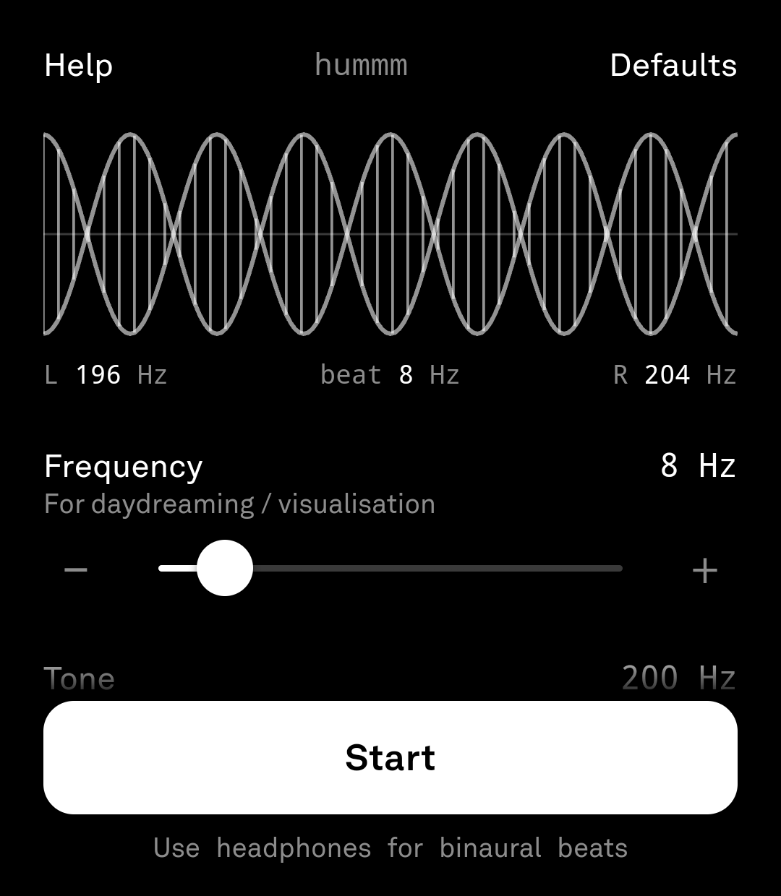
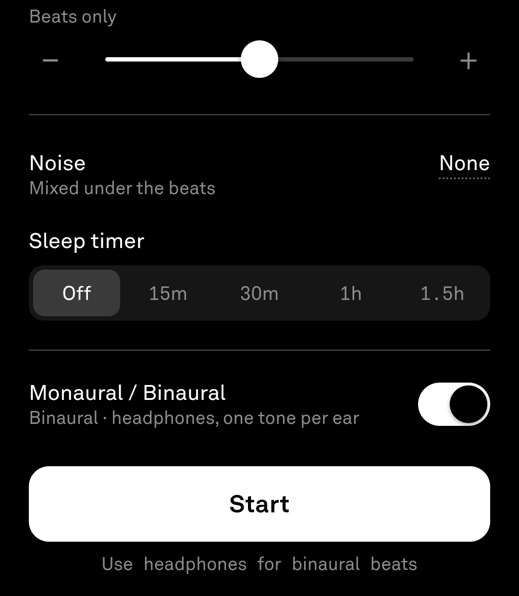
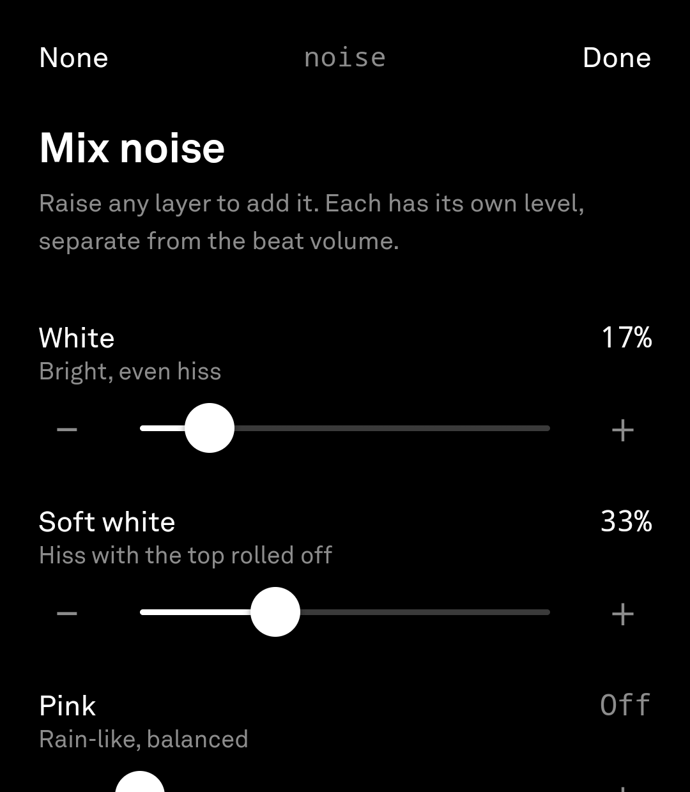
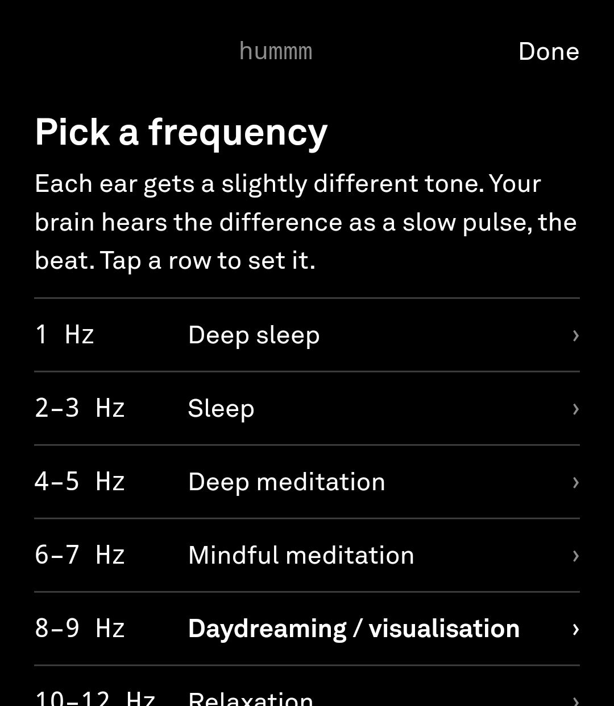

# Hummm

A minimal binaural beat generator for the Light Phone III.

Pick a beat frequency, a tone and a volume, optionally mix in some noise, and
press Start. Black and white, offline, no ads, no tracking.

<p>
  
  
  
  
</p>

## Features

- **Frequency** from 1 to 50 Hz, labelled by use:

  | Hz    | For                         |
  | ----- | --------------------------- |
  | 1     | Deep sleep                  |
  | 2–3   | Sleep                       |
  | 4–5   | Deep meditation             |
  | 6–7   | Mindful meditation          |
  | 8–9   | Daydreaming / visualisation |
  | 10–12 | Relaxation                  |
  | 13–20 | Easy wakefulness            |
  | 21–29 | Working wakefulness         |
  | 30–44 | Focus                       |
  | 45–50 | Energized focus             |

- **Tone** (60–600 Hz) sets the pitch the two tones sit around.
- **Volume** controls the beats only.
- **Noise mixer** with white, soft white, pink, brown and deep brown layers, each
  with its own level.
- **Monaural / binaural** switch. Binaural needs headphones; monaural works
  through the speaker.
- **Sleep timer** (15 min to 1.5 h) that fades out over the last 30 seconds.
- Keeps playing with the screen off.
- No internet permission. Nothing leaves the phone.

## Install

1. Download `hummm.apk` from the [latest release](https://github.com/areumkay/hummm/releases/latest).
2. Turn on USB debugging on the phone and connect it to a computer.
3. Install it with adb:

   ```bash
   adb install hummm.apk
   ```

## Build from source

The interface is a single web page, [`hummm.html`](hummm.html). The Android app
in [`android/`](android) shows it in a WebView and adds a foreground service so
audio keeps playing with the screen off.

1. Open the `android` folder in Android Studio.
2. After editing `hummm.html`, run `android/sync-web.sh` to copy it into the app.
3. Build with **Build → Build App Bundle(s) / APK(s) → Build APK(s)**, or run
   `./gradlew assembleDebug` inside `android/`.

## Credits

- Inspired by [Ooooo](https://www.bru.build/app/ooooo) by Paul Tsochantaris,
  a binaural beat app for iOS. Hummm is an independent project and isn't
  affiliated with it.
- Built with help from Claude, an AI assistant, and tested by hand on a
  Light Phone III.

## License

[MIT](LICENSE)
